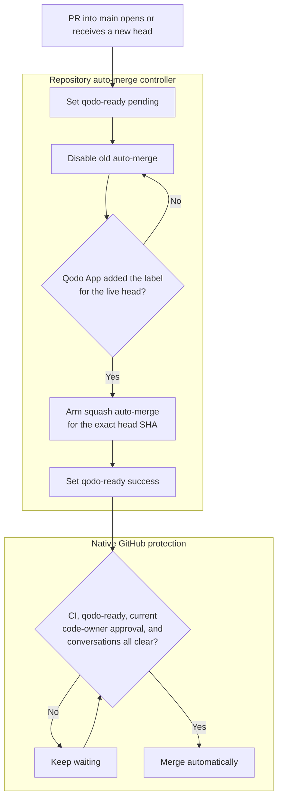

# Auto-merge controller

Pull requests into `main` are armed for squash auto-merge when Qodo approves their current head.
GitHub still decides when the merge may happen by enforcing required CI, code-owner approval,
conversation resolution, and `qodo-ready`.

The workflow uses `pull_request_target` because it needs repository secrets. It checks out only the
trusted default branch and never checks out or executes pull-request code. It also fetches the pull
request again before every ready transition and pins the auto-merge request with
`--match-head-commit`.

The label is accepted only when GitHub records Qodo's bot account, ID `151058649`, as its actor. It is
an authenticated approval event, not the durable merge gate. The controller App records that approval
as `qodo-ready` success on the exact commit. Once recorded, same-head label removal does not revoke
the approval; only a new head needs a new approval and receives its own pending status.

Before that durable status exists, every accepted pull-request event re-reads the live label timeline.
This means a later queued event cannot hide a removed or collaborator-reapplied label by replacing
the original label event. Qodo owns its label lifecycle and removes approval on a new push. The
controller never deletes that label, so a delayed reset cannot erase a newer approval.

## Scope

The controller runs only when `base == main`. This is the exact stack boundary:

- a stack parent targets an integration branch, so the controller ignores it and maintainers can
  merge it with a merge commit;
- the final integration pull request targets `main`, so the controller arms it for squash.

If an armed pull request is retargeted away from `main`, the controller disables its auto-merge
request before returning it to the integration-branch flow.

## GitHub App configuration

Install a repository-scoped GitHub App with these repository permissions:

| Permission | Access | Used for |
| --- | --- | --- |
| Contents | Write | Authorize the App to create the eventual merge commit |
| Pull requests | Write | Disable and enable auto-merge |
| Commit statuses | Write | Publish the head-bound `qodo-ready` context |

Configure the repository variable `WEBROUTER_AUTOMERGE_APP_ID` and secret
`WEBROUTER_AUTOMERGE_APP_PRIVATE_KEY`. The workflow requests a token for this repository only and the
action revokes it when the job finishes.

Bootstrap the required check without leaving an unguarded window:

1. Verify that an effective GitHub Actions policy permits `pull_request_target` for this workflow. If
   no organization policy does, create a repository policy before enabling the controller.
2. Configure the App, variable, and secret while the workflow is already on `main`.
3. Open or use a draft pull request into `main`. Let its reset run publish `qodo-ready` as pending,
   but do not add Qodo approval or mark the pull request ready.
4. Add that `qodo-ready` status to the required checks on `main`, selecting the controller App as the
   expected source.
5. Only then allow the pull request to become Qodo-ready and arm auto-merge.

Keep the existing `CI` check and every review and conversation rule unchanged throughout rollout.

## Failure and rollback

The controller fails closed. A new head posts `qodo-ready` as pending before it attempts to disable
old auto-merge, so a failure cannot leave the earlier success status active. If arming fails after
Qodo readiness was recorded, it changes that status to error. A label from any actor other than Qodo
also leaves the status pending. Stale webhook events and pull requests that never targeted `main`
make no changes; a pull request retargeted away from `main` has auto-merge disabled.

Converting an approved head back to draft disables auto-merge but preserves the authenticated,
head-bound `qodo-ready` success so the same unchanged head can become ready again. A manual label
removal on that same commit likewise does not revoke the recorded approval; pushing a commit does.

To roll back automation, disable or remove the workflow and remove `qodo-ready` from required checks.
Existing branch protection continues to block merges that lack CI, approval, or resolved conversations.
