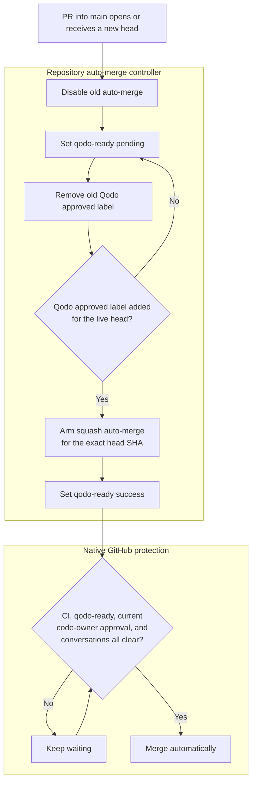

# Auto-merge controller

Pull requests into `main` are armed for squash auto-merge when Qodo approves their current head.
GitHub still decides when the merge may happen by enforcing required CI, code-owner approval,
conversation resolution, and `qodo-ready`.

The workflow uses `pull_request_target` because it needs repository secrets. It checks out only the
trusted base SHA and never checks out or executes pull-request code. It also fetches the pull request
again before every ready transition and pins the auto-merge request with `--match-head-commit`.

## Scope

The controller runs only when `base == main`. This is the exact stack boundary:

- a stack parent targets an integration branch, so the controller ignores it and maintainers can
  merge it with a merge commit;
- the final integration pull request targets `main`, so the controller arms it for squash.

## GitHub App configuration

Install a repository-scoped GitHub App with these repository permissions:

| Permission | Access | Used for |
| --- | --- | --- |
| Contents | Write | Authorize the App to create the eventual merge commit |
| Issues | Write | Remove the stale `Qodo approved` label on a new head |
| Pull requests | Write | Disable and enable auto-merge |
| Commit statuses | Write | Publish the head-bound `qodo-ready` context |

Configure the repository variable `WEBROUTER_AUTOMERGE_APP_ID` and secret
`WEBROUTER_AUTOMERGE_APP_PRIVATE_KEY`. The workflow requests a token for this repository only and the
action revokes it when the job finishes.

Bootstrap the required check without leaving an unguarded window:

1. Configure the App, variable, and secret while the workflow is already on `main`.
2. Open or use a draft pull request into `main`. Let its reset run publish `qodo-ready` as pending,
   but do not add Qodo approval or mark the pull request ready.
3. Add that App-produced `qodo-ready` status to the required checks on `main`.
4. Only then allow the pull request to become Qodo-ready and arm auto-merge.

Keep the existing `CI` check and every review and conversation rule unchanged throughout rollout.

## Failure and rollback

The controller fails closed. A new head posts `qodo-ready` as pending. If arming fails after Qodo
readiness was recorded, it changes that status to error. Stale webhook events and pull requests into
any branch other than `main` make no changes.

To roll back automation, disable or remove the workflow and remove `qodo-ready` from required checks.
Existing branch protection continues to block merges that lack CI, approval, or resolved conversations.
